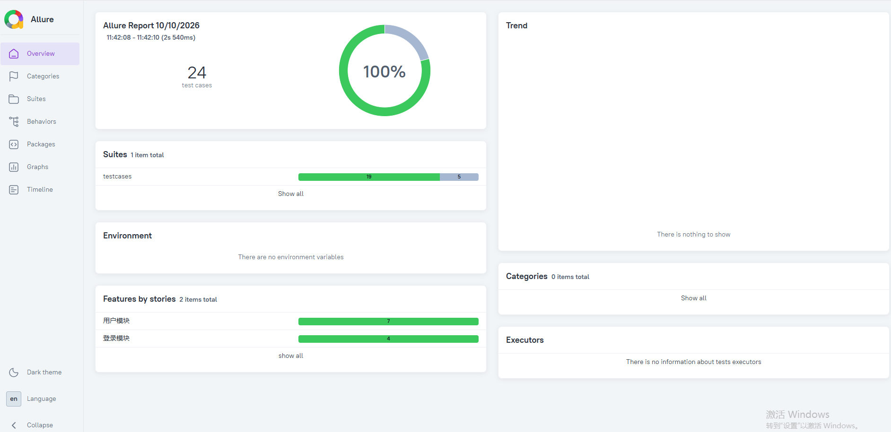

# 用户管理系统接口自动化测试

这是一个用 Python + pytest 编写的接口自动化测试项目，
用于测试用户管理系统的登录，用户查询，用户新增，删除接口等。

## 技术栈

- Python 3
- pytest：用例管理与执行
- requests：发送 HTTP 请求
- Allure：生成测试报告
- sqlite3：数据库校验

## 项目结构

- `config/`：存放环境配置，比如接口地址、超时时间
- `common/`：存放通用工具，比如请求封装、数据库封装
- `api/`：存放接口定义，每个接口封装成一个函数
- `testcases/`：存放测试用例
- `conftest.py`：存放公共的前置操作

## 运行方式

### 1. 启动被测服务

```
python myapi.py
```

### 2. 执行测试
```
pytest -v
```

### 3. 查看测试报告
```
pytest -v --alluredir=./allure-results --clean-alluredir
allure serve ./allure-results
```

## 测试覆盖

共24条用例，19条通过，5条标记为已知缺陷。

### 登录模块
- 正确账号密码登录成功
- 密码错误、账号为空、密码为空
- 用户名大小写敏感

### 用户模块

- 带 token / 不带 token /假 token 查询列表
- 新增用户 + 数据库校验
- 删除用户 + 数据库校验
- 删除不存在的id、负数 id、非数字 id

### 发现的缺陷

- BUG-001：手机号未做格式和长度校验，填字母、空格、超长都能新增成功
- BUG-002：用户名未做长度校验，100个中文字符也能新增成功

## 测试报告




